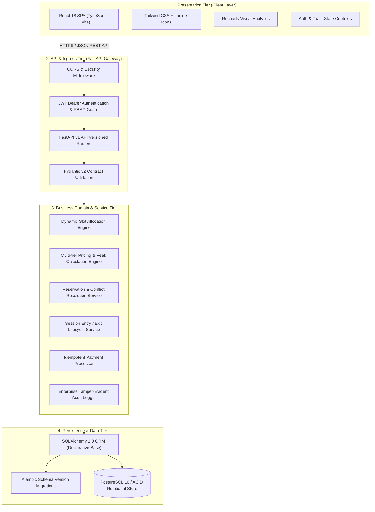

# ParkNexus System Architecture & Enterprise Design

## 1. Executive Summary

**ParkNexus** is a real-time, distributed intelligent parking management and dynamic resource allocation system designed for modern multi-tier enterprise parking infrastructures. Built to fulfill the enterprise software engineering standards of the **Building Enterprise Applications (BEA)** curriculum, the platform unifies real-time spatial asset scheduling, dynamic pricing, automated vehicle verification, entry/exit physical gating workflows, and revenue analytics into a cloud-native architecture.

---

## 2. Enterprise Architectural Pattern

ParkNexus employs a strict **Layered Enterprise Architecture (Separation of Concerns)** with Domain-Driven Design (DDD) principles:

### Architectural Tiers Breakdown

1. **Presentation Tier (React 18 + TypeScript + Vite)**
   - Single Page Application (SPA) designed according to modern enterprise SaaS standards (Stripe/Linear design language).
   - Component isolation with atomic design principles: Layouts, Shared Components, Role-Specific Domain Pages.
   - Client-side routing with granular RBAC Route Guards protecting `CUSTOMER`, `PARKING_STAFF`, and `ADMIN` views.
   - Real-time interactive spatial map rendering parking slots with distinct visual state indicators (Available, Occupied, Reserved, Maintenance).

2. **Ingress & API Gateway Tier (FastAPI)**
   - High-throughput asynchronous ASGI web server using Uvicorn.
   - OpenAPI 3.1 contract generation with automated Swagger and Redoc documentation.
   - Centralized authentication using cryptographically signed JSON Web Tokens (HMAC-SHA256).
   - Strict input sanitization and schema contracts backed by Pydantic v2.

3. **Domain & Business Logic Service Tier**
   - **Allocation Engine**: Multi-objective heuristics scoring slots based on vehicle type suitability, entry proximity, zone balancing, and accessibility flags.
   - **Pricing Engine**: Dynamic hourly pricing with weekend multipliers, vehicle category surcharges, peak-hour surcharges, and grace periods.
   - **Reservation & Concurrency Manager**: Transactional isolation ensuring double-booking prevention under concurrent requests.
   - **Session Lifecycle Processor**: Manages real-time vehicle check-in, duration tracking, overstay penalties, and physical slot state synchronization.
   - **Enterprise Audit Engine**: Captures actors, IP origins, actions, before-and-after states, and event timestamps for governance compliance.

4. **Persistence & Data Tier (PostgreSQL 16 + SQLAlchemy 2.0)**
   - Strict ACID transaction semantics.
   - Foreign key integrity, unique compound indexes, and check constraints.
   - Database schema evolution managed via Alembic version-controlled migrations.

---

## 3. Role-Based Access Control (RBAC) Matrix

ParkNexus implements enterprise role-based authorization at both API endpoints and presentation routes:

| Resource / Action | Customer | Parking Staff | Administrator |
| :--- | :---: | :---: | :---: |
| **Browse Facilities & Slots** | Read-Only | Read-Only | Full Access |
| **Manage Vehicles** | Own Vehicles Only | Read-Only | Full Access |
| **Create Reservation** | Yes | Yes (Over-the-counter) | Yes |
| **Dynamic Slot Allocation** | Trigger & Choose | Trigger & Choose | Trigger & Choose |
| **Simulate Payment** | Own Bookings | Yes | Yes |
| **Process Vehicle Entry (Check-In)** | No | Yes | Yes |
| **Process Vehicle Exit (Checkout)** | No | Yes | Yes |
| **Facility & Slot Configuration** | No | No | Full CRUD |
| **Dynamic Pricing Plans** | Read | Read | Full CRUD |
| **Manage Complaints & Disputes** | File & View Own | Update Status | Full Resolution & Stats |
| **User & Staff Management** | No | No | Full CRUD |
| **Financial & Occupancy Analytics** | Personal Stats | Facility Daily Stats | Enterprise-wide Analytics |
| **System Audit Logs** | No | No | Read-Only Audit Access |

---

## 4. Cross-Cutting Enterprise Concerns

### 4.1 Transaction Management & Concurrency Control
- **Double-Booking Prevention**: When creating reservations or parking sessions, the service layer evaluates overlapping temporal intervals `[start_time, end_time]` against active reservations and ongoing sessions for the requested slot.
- **Pessimistic Locking / Transaction Isolation**: Critical state transitions (such as slot status updates and payment receipts) execute within atomic SQLAlchemy sessions with immediate rollback on exceptions.

### 4.2 Idempotency in Payments & Billing
- Every payment transaction generates a cryptographically unique transaction ID (`TXN-<TIMESTAMP>-<UUID>`).
- Re-submitting payment for an already paid reservation or session returns the existing payment record with status `COMPLETED`, preventing duplicate charges.

### 4.3 Enterprise Audit Logging
- Every state-modifying action (facility creation, price tier update, slot status override, payment capture, complaint resolution) automatically persists an immutable record to the `audit_logs` table.
- Logs include: `user_id`, `action`, `resource_type`, `resource_id`, `details` (JSON payload containing changes), `ip_address`, and `created_at`.
