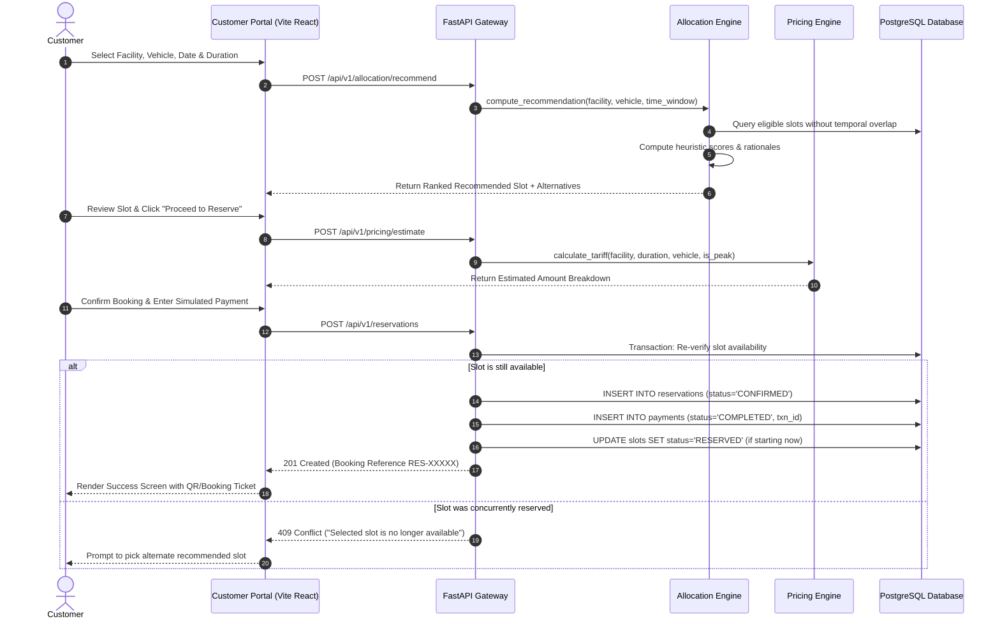
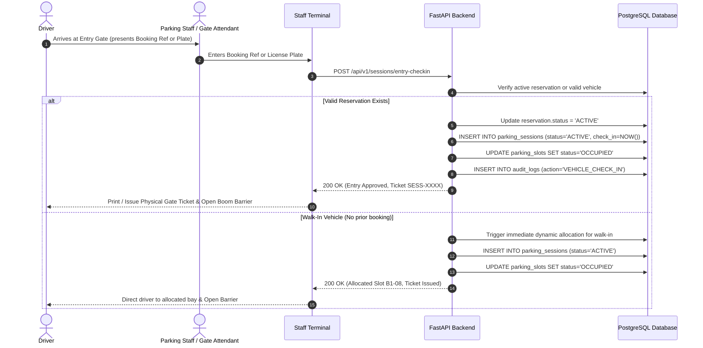
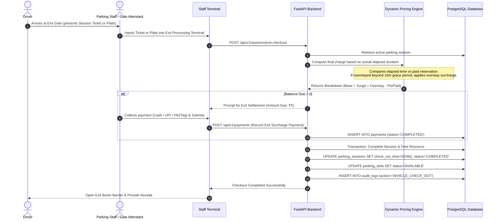

# ParkNexus Business Workflows & Dynamic Resource Allocation

## 1. Dynamic Slot Allocation Engine

### 1.1 Overview
The signature feature of ParkNexus is its **Rule-Based Multi-Factor Dynamic Slot Allocation Engine**. Rather than simply returning an arbitrary available slot, ParkNexus scores all eligible candidates based on real-world operational constraints and spatial heuristics to optimize facility throughput, minimize driving/walking distances, balance zone occupancy, and ensure equipment compatibility.

### 1.2 Mathematical Formulation & Heuristic Scoring

For a given allocation request:
$$\text{Request} = \{ \text{facility\_id}, \text{vehicle\_type}, \text{start\_time}, \text{end\_time}, \text{accessible\_pref}, \text{charger\_pref} \}$$

The engine executes in two distinct stages:

#### Stage 1: Hard Eligibility Constraints (Filtering)
A slot $s$ is added to candidate set $C$ if and only if:
1. **Facility Membership**: $s \in \text{Slots}(\text{facility\_id})$
2. **Operational Status**: $\text{status}(s) \neq \text{MAINTENANCE}$
3. **Vehicle Type Compatibility**:
   - `TWO_WHEELER` vehicle $\to$ Slot category MUST be `TWO_WHEELER` or `STANDARD`
   - `ELECTRIC_VEHICLE` vehicle $\to$ Prioritizes `ELECTRIC_VEHICLE` (with charger), accepts `STANDARD`
   - `FOUR_WHEELER` vehicle $\to$ Accepts `STANDARD` or `ELECTRIC_VEHICLE` (if no charger requested)
4. **Temporal Conflict Isolation**: Slot $s$ has NO overlapping active reservation or active parking session during $[start\_time, end\_time]$:
   $$\forall r \in \text{Reservations}(s), \; [r.start, r.end] \cap [start\_time, end\_time] = \emptyset$$
   $$\forall p \in \text{ActiveSessions}(s), \; [p.check\_in, \infty) \cap [start\_time, end\_time] = \emptyset$$

#### Stage 2: Multi-Factor Weighted Scoring
For every candidate slot $s \in C$, an objective score $S(s)$ is computed (Base score = 100.0):

$$S(s) = S_{\text{base}} + W_{\text{entry}} + W_{\text{floor}} + W_{\text{feature}} + W_{\text{balance}}$$

Where:
- **Proximity Weight ($W_{\text{entry}}$)**: Penalizes walking distance from entrance gates.
  $$W_{\text{entry}} = -\min\left(30, \; \frac{\text{distance\_from\_entry}(s)}{2}\right)$$
- **Vertical Level Weight ($W_{\text{floor}}$)**: Ground floor ($0$) and Level 1 ($1$) provide optimal accessibility compared to deep basement levels:
  $$W_{\text{floor}} = \begin{cases} +10 & \text{if floor} = 0 \\ +5 & \text{if floor} = 1 \\ -5 \times |\text{floor}| & \text{if floor} < 0 \end{cases}$$
- **Feature Affinity Bonus ($W_{\text{feature}}$)**:
  - If EV requested and $s$ has active EV charger: $+25$
  - If Accessible parking requested and $s$ is designated accessible: $+30$
  - Penalty if standard vehicle consumes an EV charging bay when non-EV slots remain: $-15$
- **Zone Occupancy Load Balancing ($W_{\text{balance}}$)**: Prevents bottlenecking in a single zone by incentivizing lower-occupancy zones:
  $$W_{\text{balance}} = +10 \times \left(1.0 - \frac{\text{OccupiedSlots}(\text{zone}(s))}{\text{TotalSlots}(\text{zone}(s))}\right)$$

The slot with the highest composite score $S^* = \max_{s \in C} S(s)$ is selected as the **Recommended Slot**, along with a human-readable transparent explanation (e.g., *"Ground level EV slot closest to facility entrance (12m) with zone capacity at 45%"*).

---

## 2. Reservation & Dynamic Booking Lifecycle

---

## 3. Vehicle Physical Entry & Check-In Lifecycle

---

## 4. Vehicle Physical Exit, Billing & Checkout Lifecycle

