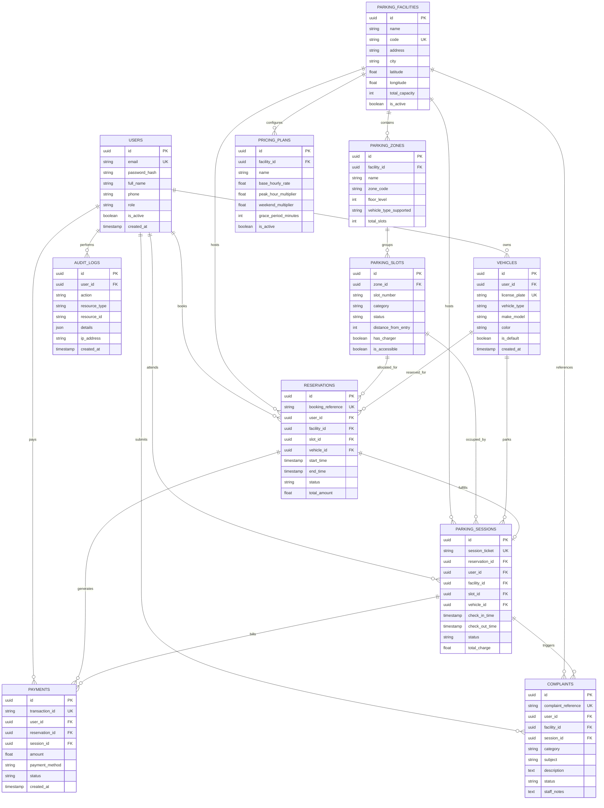

# ParkNexus Relational Database Design & Schema Dictionary

## 1. Relational Data Architecture

ParkNexus employs a normalized (3NF) relational database schema architected for high-concurrency spatial scheduling, ACID transactional integrity, and operational auditability.

---

## 2. Entity-Relationship (ER) Diagram

---

## 3. Data Dictionary & Table Specifications

### 3.1 `users`
Represents registered platform actors with strict role boundaries.
- `id` (UUID, Primary Key): Unique surrogate identity.
- `email` (VARCHAR(255), Unique, Indexed, Not Null): Canonical login identifier.
- `password_hash` (VARCHAR(255), Not Null): Cryptographic Bcrypt hash. Plaintext passwords are never stored.
- `full_name` (VARCHAR(255), Not Null): Customer or staff display name.
- `phone` (VARCHAR(30), Nullable): Contact phone number.
- `role` (VARCHAR(30), Not Null, Indexed): Role enumeration (`CUSTOMER`, `PARKING_STAFF`, `ADMIN`).
- `is_active` (BOOLEAN, Default True): Soft-activation flag for access revocation.
- `created_at` (TIMESTAMP WITH TIME ZONE, Default CURRENT_TIMESTAMP).

### 3.2 `vehicles`
Represents customer-owned automotive assets.
- `id` (UUID, Primary Key).
- `user_id` (UUID, Foreign Key -> `users.id`, Indexed): Owning customer.
- `license_plate` (VARCHAR(30), Unique, Indexed, Not Null): Standard vehicle registration mark (e.g., `KA-01-MJ-5021`).
- `vehicle_type` (VARCHAR(30), Not Null): Vehicle category (`TWO_WHEELER`, `FOUR_WHEELER`, `ELECTRIC_VEHICLE`, `OTHER`).
- `make_model` (VARCHAR(100), Not Null): Manufacturer and model name.
- `color` (VARCHAR(50), Nullable): Visual color for staff verification.
- `is_default` (BOOLEAN, Default False): Shortcut selection flag in customer reservation wizard.

### 3.3 `parking_facilities`
Represents independent physical parking real estate hubs.
- `id` (UUID, Primary Key).
- `name` (VARCHAR(255), Not Null): Commercial facility name.
- `code` (VARCHAR(30), Unique, Indexed, Not Null): Internal identifier code (e.g., `BTP-01`).
- `address`, `city` (VARCHAR, Not Null): Geographic address.
- `latitude`, `longitude` (FLOAT, Nullable): Geospatial coordinates for mapping and discovery.
- `total_capacity` (INTEGER, Not Null): Total aggregate slot capacity.
- `is_active` (BOOLEAN, Default True).

### 3.4 `parking_zones`
Divisions within a facility representing physical architectural levels or sections.
- `id` (UUID, Primary Key).
- `facility_id` (UUID, Foreign Key -> `parking_facilities.id`, Indexed).
- `name` (VARCHAR(100), Not Null): Descriptive name (e.g., `Basement 1`, `Ground VIP Zone`).
- `zone_code` (VARCHAR(30), Not Null): Internal zone tag (e.g., `Z-B1`).
- `floor_level` (INTEGER, Not Null): Floor indicator (e.g., `-2`, `-1`, `0`, `1`).
- `vehicle_type_supported` (VARCHAR(50), Not Null): Compatibility constraint.

### 3.5 `parking_slots`
The fundamental inventory unit representing a single physical space.
- `id` (UUID, Primary Key).
- `zone_id` (UUID, Foreign Key -> `parking_zones.id`, Indexed).
- `slot_number` (VARCHAR(30), Not Null, Indexed): Visible physical slot signage (e.g., `B1-EV-01`).
- `category` (VARCHAR(30), Not Null): Category (`STANDARD`, `TWO_WHEELER`, `ELECTRIC_VEHICLE`, `ACCESSIBLE`).
- `status` (VARCHAR(30), Not Null, Indexed): Operational state (`AVAILABLE`, `OCCUPIED`, `RESERVED`, `MAINTENANCE`).
- `distance_from_entry` (INTEGER, Default 10): Relative walking distance in meters from main vehicle entrance (used by Dynamic Allocation heuristic).
- `has_charger` (BOOLEAN, Default False): EV Charging station available at slot.
- `is_accessible` (BOOLEAN, Default False): ADA / Accessible design geometry.

### 3.6 `pricing_plans`
Dynamic billing policies attached to parking facilities.
- `id` (UUID, Primary Key).
- `facility_id` (UUID, Foreign Key -> `parking_facilities.id`, Indexed).
- `name` (VARCHAR(100), Not Null): Policy moniker (e.g., `Standard Dynamic Tariff`).
- `base_hourly_rate` (FLOAT, Not Null): Base rate in local currency per hour.
- `peak_hour_multiplier` (FLOAT, Default 1.25): Surge multiplier applied during peak hours (08:00–11:00 and 17:00–20:00).
- `weekend_multiplier` (FLOAT, Default 1.15): Applied on Saturday and Sunday.
- `grace_period_minutes` (INTEGER, Default 15): Free-of-charge entry-to-exit cancellation window.

### 3.7 `reservations`
Pre-booked scheduling contracts reserving a slot for a temporal duration.
- `id` (UUID, Primary Key).
- `booking_reference` (VARCHAR(30), Unique, Indexed, Not Null): Formatted alphanumeric token (e.g., `RES-8F92A1`).
- `user_id`, `facility_id`, `slot_id`, `vehicle_id` (Foreign Keys with indexes).
- `start_time`, `end_time` (TIMESTAMP WITH TIME ZONE, Not Null): Reserved duration.
- `status` (VARCHAR(30), Not Null, Indexed): Lifecycle state (`CONFIRMED`, `ACTIVE`, `COMPLETED`, `CANCELLED`, `EXPIRED`).
- `total_amount` (FLOAT, Not Null): Calculated booking fee.

### 3.8 `parking_sessions`
Physical occupancy records tracking actual vehicle presence from gate entry to exit.
- `id` (UUID, Primary Key).
- `session_ticket` (VARCHAR(30), Unique, Indexed, Not Null): Barcode / token issued at gate (e.g., `SESS-3C79D4`).
- `reservation_id` (UUID, Foreign Key -> `reservations.id`, Nullable): Linked reservation for pre-booked entries, null for walk-ins.
- `check_in_time` (TIMESTAMP WITH TIME ZONE, Not Null): Physical entry timestamp.
- `check_out_time` (TIMESTAMP WITH TIME ZONE, Nullable): Physical exit timestamp.
- `status` (VARCHAR(30), Not Null, Indexed): State (`ACTIVE`, `COMPLETED`, `OVERSTAY`).
- `total_charge` (FLOAT, Default 0.0): Real-time calculated billing charge upon exit.

### 3.9 `payments`
Idempotent financial ledger entries.
- `id` (UUID, Primary Key).
- `transaction_id` (VARCHAR(100), Unique, Indexed, Not Null): Bank / Gateway reference (e.g., `TXN-173050-984A`).
- `amount` (FLOAT, Not Null): Transaction value.
- `payment_method` (VARCHAR(50), Not Null): Method (`CREDIT_CARD`, `UPI`, `NET_BANKING`, `FASTAG_WALLET`, `CASH`).
- `status` (VARCHAR(30), Not Null): Settlement status (`COMPLETED`, `PENDING`, `FAILED`, `REFUNDED`).

### 3.10 `complaints`
Customer issue escalation and dispute management records.
- `id` (UUID, Primary Key).
- `complaint_reference` (VARCHAR(30), Unique, Indexed, Not Null): E.g., `CMP-0042`.
- `category` (VARCHAR(50), Not Null): E.g., `OVERCHARGED`, `DAMAGED_EQUIPMENT`, `SLOT_BLOCKED`.
- `status` (VARCHAR(30), Not Null, Indexed): `OPEN`, `IN_PROGRESS`, `RESOLVED`, `CLOSED`.

### 3.11 `audit_logs`
Enterprise governance ledger recording immutable administrative and operational actions.
- `id` (UUID, Primary Key).
- `user_id` (UUID, Foreign Key -> `users.id`, Indexed).
- `action` (VARCHAR(100), Not Null): E.g., `SLOT_STATUS_OVERRIDE`, `PRICING_UPDATED`.
- `resource_type`, `resource_id` (VARCHAR, Indexed): E.g., `Slot`, `Facility`.
- `details` (JSON): Serialized snapshot of before-and-after values.
- `ip_address` (VARCHAR(45), Nullable).
- `created_at` (TIMESTAMP WITH TIME ZONE, Default CURRENT_TIMESTAMP).
